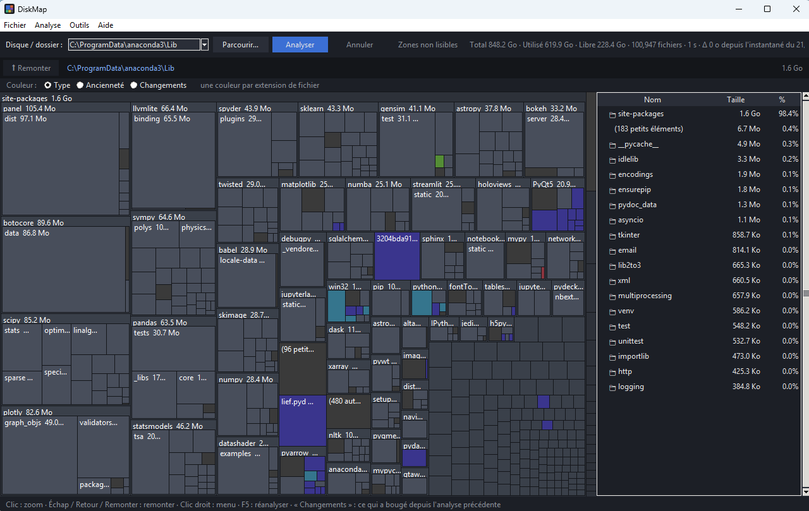

# DiskMap

[](https://github.com/Toff1989/diskmap/actions/workflows/tests.yml)
[](https://github.com/Toff1989/diskmap/releases/latest)
[](https://www.python.org/)
[](#télécharger)
[](#lancer-depuis-les-sources)
[](#lecture-seule)
[](LICENSE)

**Vois d'un coup d'œil ce qui remplit ton disque.** DiskMap analyse un disque ou un dossier et l'affiche
en treemap interactive : plus un rectangle est grand, plus il pèse lourd. Windows, macOS et Linux, sans
aucune dépendance (interface tkinter, incluse avec Python).



## Télécharger

Les installeurs sont dans la [dernière release](https://github.com/Toff1989/diskmap/releases/latest) :

| Système | Fichier |
|---|---|
| Windows | `DiskMap-<version>-setup.exe` (installeur) ou `…-windows-x64.zip` (portable) |
| macOS (Apple Silicon) | `DiskMap-<version>-macos-arm64.dmg` |
| Linux | `diskmap_<version>_amd64.deb` ou `DiskMap-<version>-linux-x64.tar.gz` |

Les exécutables ne sont pas signés : SmartScreen (Windows) peut afficher un avertissement, et sur macOS il
faut faire clic droit › Ouvrir au premier lancement.

## Lancer depuis les sources

Python 3.8+ avec tkinter, rien d'autre à installer :

```bash
python -m diskmap            # ouvre la fenêtre
python -m diskmap C:\        # analyse directement un disque ou un dossier
```

Ou, après `pip install .`, la commande `diskmap`.

**Windows : droits administrateur automatiques.** Au lancement, DiskMap se relance lui-même en
administrateur (invite UAC) pour lire les dossiers protégés. Si tu refuses l'invite, il s'ouvre quand
même, avec des droits normaux. `--no-admin` désactive la demande. Sous Linux et macOS, utilise `sudo`
pour inclure les dossiers protégés.

## Utilisation

| Action | Effet |
|---|---|
| Clic sur un dossier | zoom dedans |
| Échap / Retour / « Remonter » | remonter d'un niveau |
| Fil d'Ariane | revenir à n'importe quel niveau |
| Double-clic dans la liste de droite | entrer dans le dossier |
| Clic droit | ouvrir l'emplacement, copier le chemin |
| F5 | réanalyser |

## Fonctions

| Fonction | Où | Ce que ça fait |
|---|---|---|
| **Machine à remonter le temps** | Analyse › Comparer à un instantané… | Un instantané compressé est enregistré après chaque analyse (`~/.diskmap/snapshots`, 30 par chemin). La carte **Changements** montre ce qui a grossi (rouge) ou rétréci (vert) ; l'analyse précédente sert de base automatiquement. |
| **Comparer deux dossiers / disques** | Analyse › Comparer à un autre dossier… | Même carte de différences entre une source et sa sauvegarde, par exemple. |
| **Doublons** | Outils › Doublons… | Taille, empreinte partielle, puis empreinte complète ; liens physiques ignorés. Un groupe = une couleur surlignée sur la carte, avec l'espace récupérable. |
| **Que supprimer ?** | Outils › Que supprimer ? | Catalogue de caches et dossiers régénérables (`node_modules`, `__pycache__`, DerivedData, Docker, Windows Update…) classés par *espace × sécurité*, avec l'explication et la commande conseillée. |
| **Fichiers froids** | même fenêtre, 2ᵉ onglet · Couleur › Ancienneté | Carte colorée par date de dernière modification ; liste des plus gros éléments intouchés depuis 1, 2 ou 5 ans. |
| **Surveillance en direct** | Analyse › Surveiller le dossier affiché | Réanalyse le dossier affiché toutes les 5 à 60 s ; ce qui grossit est entouré en orange. |
| **Projets de code** | Outils › Projets de code… | Sources / dépôt Git / dépendances et builds par projet (Node, Python, Rust, Go, Java, .NET…). |
| **Rapport HTML** | Fichier › Exporter un rapport HTML… | Page autonome avec treemap interactive (zoom, infobulles, couleur par type ou ancienneté). |

Sans fenêtre : `python -m diskmap C:\ --snapshot` et `python -m diskmap C:\ --export-html rapport.html`
(utile en tâche planifiée pour construire l'historique).

### Lecture seule

DiskMap ne supprime, ne déplace et ne modifie **jamais** aucun fichier : les outils expliquent et proposent,
c'est toi qui décides.

### Pourquoi certaines zones ne sont pas détaillées

- **Bloc rouge « 🔒 Non lisible »** : espace utilisé sur le disque mais impossible à lire (points de
  restauration, `WindowsApps`, corbeilles d'autres comptes, métadonnées NTFS…). Survole-le pour
  l'explication ; le bouton **« Zones non lisibles »** liste chaque dossier refusé avec sa raison.
- **Alias et jonctions** (`Documents and Settings`, liens symboliques) : ignorés exprès, l'espace est déjà
  compté à l'emplacement réel.
- **OneDrive** : les dossiers cloud sont suivis. Les fichiers « en ligne seulement » n'occupent pas de place
  locale : ils sont comptés à part (☁) et pas dans la carte, et ne sont jamais lus (ce qui les téléchargerait).
- **Éléments minuscules** : regroupés dans « (N petits éléments) » pour que la carte reste lisible.

## Structure

```
diskmap/
  core/              logique sans interface (testable sans tkinter)
    models.py          Node, ScanResult, SkipEntry
    scanner.py         parcours du disque, annulation, regroupement des petits éléments
    treemap.py         algorithme squarified treemap
    drives.py          détection des disques par OS
    explain.py         explications des zones non lisibles
    formatting.py      formatage des tailles
    tree.py            parcours et chemins dans l'arbre
    age.py             tranches d'ancienneté
    diff.py            carte des changements entre deux arbres
    snapshot.py        instantanés compressés (enregistrer, lister, charger)
    duplicates.py      recherche de doublons
    cleanup.py         catalogue de nettoyage, fichiers froids
    projects.py        détection des projets de code
    export.py          rapport HTML autonome
  ui/                interface tkinter
    app.py             fenêtre principale, pilotage du scan en thread
    treemap_view.py    canvas de la treemap + souris
    entry_list.py      liste du dossier courant
    navbar.py          « Remonter » + fil d'Ariane
    toolbar.py         sélection du disque, boutons Analyser / Annuler
    modebar.py         mode de couleur (type / ancienneté / changements) + légende
    dialogs.py         fenêtres : instantanés, doublons, nettoyage, projets
    skipped_dialog.py  fenêtre « Zones non lisibles »
    theme.py           couleurs et styles
    system.py          intégration explorateur de fichiers
  assets/            icône de la fenêtre
  elevation.py       relance en administrateur (Windows)
  __main__.py        point d'entrée (python -m diskmap)
packaging/           scripts de build Windows / macOS / Linux
tests/               tests du cœur et de l'interface
docs/                capture d'écran
```

## Développement

```bash
pip install -e .[dev]
pytest
```

La CI exécute les tests sur Linux (Python 3.8 et 3.12), Windows et macOS à chaque push et pull request.
Pour construire les exécutables : [packaging/README.md](packaging/README.md). L'historique des versions est
dans le [CHANGELOG](CHANGELOG.md).

## Licence

[MIT](LICENSE)
